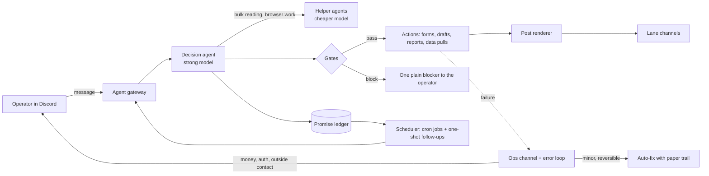

# Architecture

## Flow of one job

1. The scheduler fires a job (for example, the morning job-search report).
2. The agent does the work, delegating heavy reading to helper agents.
3. Any irreversible step goes through a gate (pre-submit, sign-in guard, two-step approval).
4. The result is rendered into the standard post shape and posted to that lane's channel.
5. If the agent names a next step it can't finish now, it registers a promise; the scheduler fires
   a follow-up at the due time.
6. A failure prints one plain sentence, is recorded for the ops channel, and the error loop either
   auto-fixes it (minor, reversible) or escalates it.
